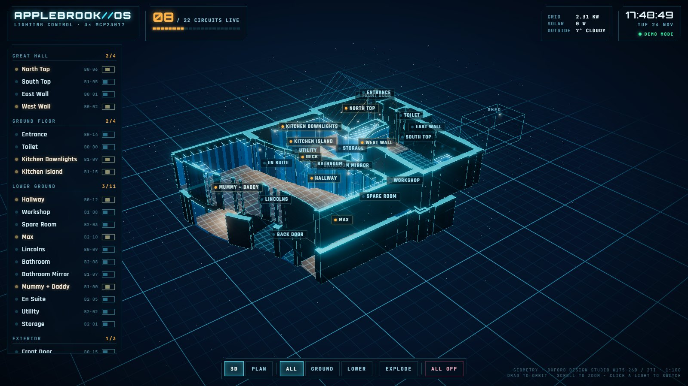
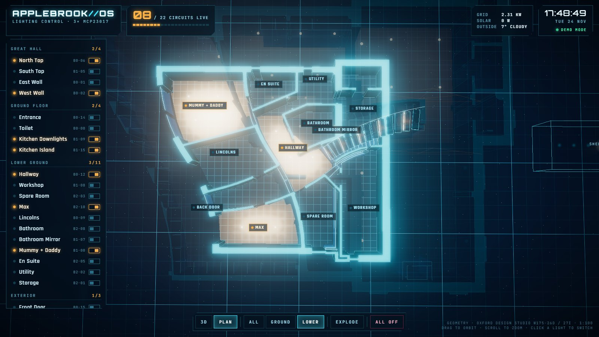

# HOUSE//OS: 3D lighting console

A holographic 3D model of Apple Brook House with every light circuit live and clickable. It runs as a
Lovelace card (`custom:house-os-card`) and works on desktop, tablet and the phone app.




*(Screenshots are from demo mode.)*

## What it does

- **True-scale geometry.** Walls are traced from Oxford Design Studio's GA plans
  (`W175-26D` ground floor and `W175-27I` lower ground floor, both 1:100, in the ChadHouse repo).
  The tidied 2021 floorplans in `www/img` are registered to the PDFs using SIFT, and the two floors
  are aligned on the shared dimension ticks. Floor levels come from the plans: lower ground is 107.0,
  ground is 109.9 and the great hall is 110.25.
- **Live lights.** HA's switch state *is* the light state (each MCP23017 output holds a relay), so rooms
  glow, cones of light appear and the walls pick up warm light the moment a state changes. That includes
  switching from a wall switch or another phone.
- **Click anything** to toggle it: a light, a room floor, a floating label or a row in the list. A ring
  ripples out from the fixture and the inspector shows the room photo (from the Nov 2026 walkthrough
  video), the channel (`BANK 1 · PIN 09 · MCP23017 @ 0x21`), the entity, and how long it has been in its state.
- **Views:** 3D orbit (auto-rotates when idle), top-down PLAN, ALL / GROUND / LOWER floor focus, and
  EXPLODE (lifts the ground floor off).
- **Curved staircase.** It sweeps between the floors with all 14 `StairLight_NN` LEDs, one per step,
  and the handrail.
- **Roof wireframe** over the great hall, with the two oak trusses picked out.
- **Shed** satellite with the 5 workshop lights (`light.*`).
- **ALL OFF** (press twice to confirm). A scan plane sweeps west to east and switches off each lit circuit as it passes.
- **HUD:** circuits-lit counter, grid power, solar, outside temperature, clock, link status.

## Files

| Path | What |
|---|---|
| `www/house-os/house-os.js` | The card (plain ES module, no build step) |
| `www/house-os/house.json` | Geometry (walls, glazing, room zones, stair arc) and the light→room→fixture map |
| `www/house-os/vendor/` | three.js r170 and the addons it uses, imports rewritten to be relative (no CDN needed) |
| `www/house-os/img/` | Room stills from the walkthrough video. **Git-ignored** (private interiors). Regenerate from `E:\Video\C1895.MP4` |
| `www/house-os/dev.html` | Standalone harness: `dev.html#demo` (simulated) or `dev.html#token=<HA access token>` (live) |

## Install in Home Assistant

1. Copy the whole `www/house-os/` folder (including `img/`) to `/config/www/house-os/` on the HA box,
   e.g. drag it into **Studio Code Server**, or use `scp -r` through the **Advanced SSH** add-on.
2. Settings → Dashboards → ⋮ → **Resources** → add `/local/house-os/house-os.js?v=1` as a *JavaScript module*.
3. Settings → Dashboards → **Add dashboard** (e.g. "House", icon `mdi:home-lightning-bolt`). Add a view with
   **View type: Panel (single card)** and the card:
   ```yaml
   type: custom:house-os-card
   ```
   The existing dashboards are untouched.

Bump `?v=` after updating files so browsers fetch the new version.

## Light map

Matched by aligning the walkthrough narration (Whisper transcript) with the HA logbook. Every switch press
on the video lines up with a logbook entry once you offset by 16:53:49 UTC.

| Circuit | Entity | Where |
|---|---|---|
| Front Door | `light_bank_0_pin_15` | outside D1 |
| Entrance | `light_bank_0_pin_14` | entrance |
| Toilet | `light_bank_0_pin_00` | WC |
| North Top / South Top | `0_06` / `1_05` | great hall, north / south half |
| East Wall / West Wall | `0_01` / `0_02` | great hall wall lights |
| Kitchen Downlights / Island | `1_09` / `1_15` | kitchen-dining |
| Deck | `0_10` | deck lights along the glazing |
| Hallway | `0_12` | lower ground hallway |
| Workshop | `1_08` | lower ground, under the living room |
| Spare Room | `2_03` | bed 4 |
| Max | `2_10` | bed 2 *(assumed; swap with Lincolns if wrong)* |
| Lincolns | `0_09` | bed 3 *(assumed)* |
| Back Door | `2_14` | outside D3, end of the bedroom corridor |
| Bathroom / Bathroom Mirror | `2_08` / **`1_07`** | main bathroom. 1_07 was unlabelled until the video |
| Mummy + Daddy / En Suite | `1_00` / `2_05` | bed 1 and its en suite |
| Utility / Storage | `2_02` / `2_01` | |

To change a mapping or move a fixture, edit `lights[]` in `house.json`: `room` is a zone id and `fixtures`
are plan coordinates in metres (origin at the NW dimension tick, x east, y south).
