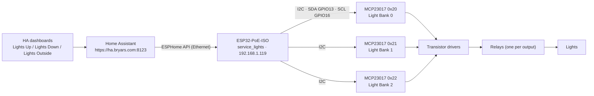
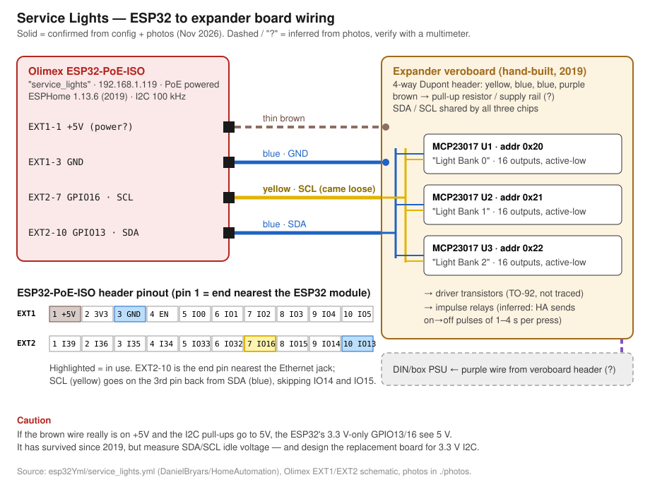
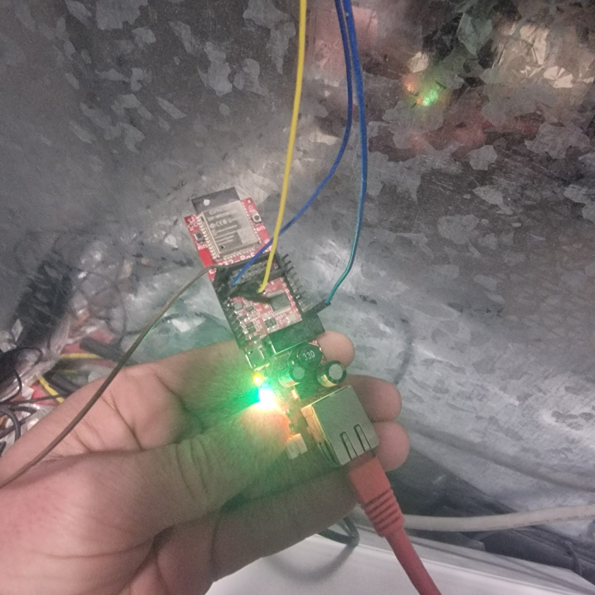
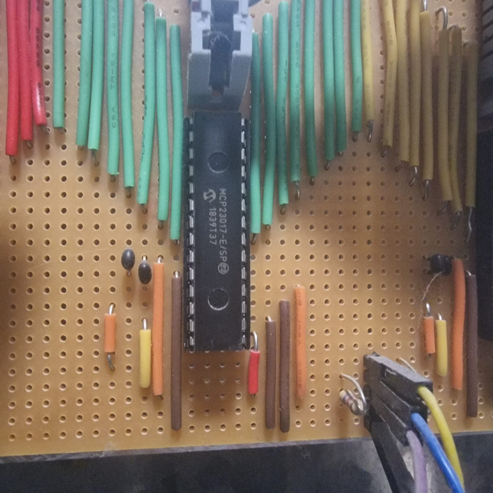
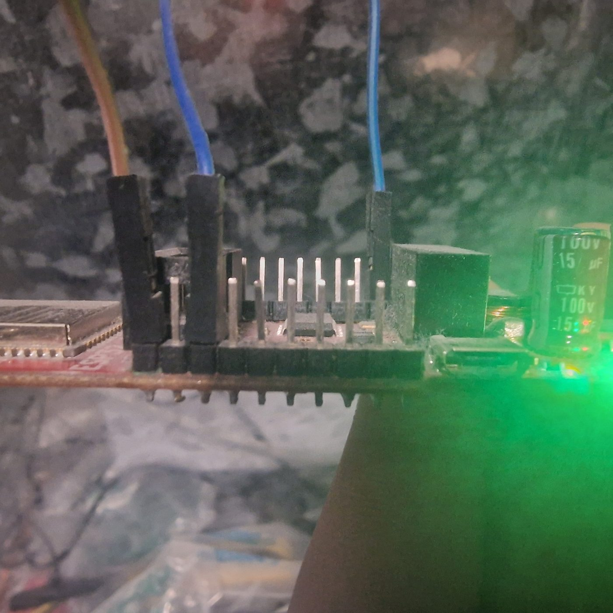
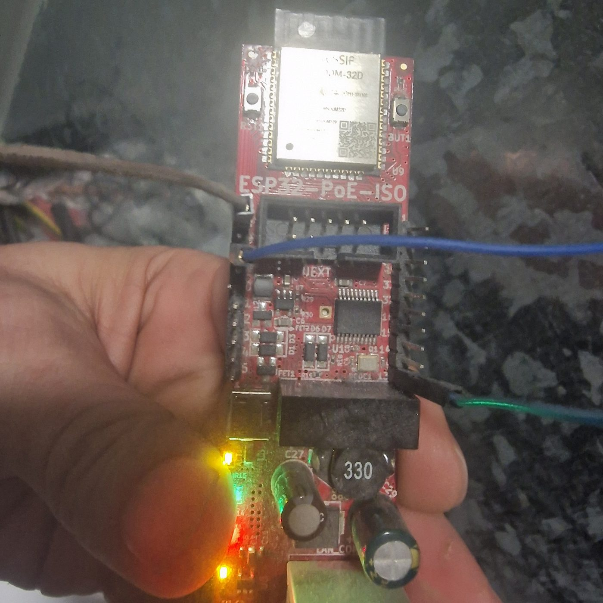
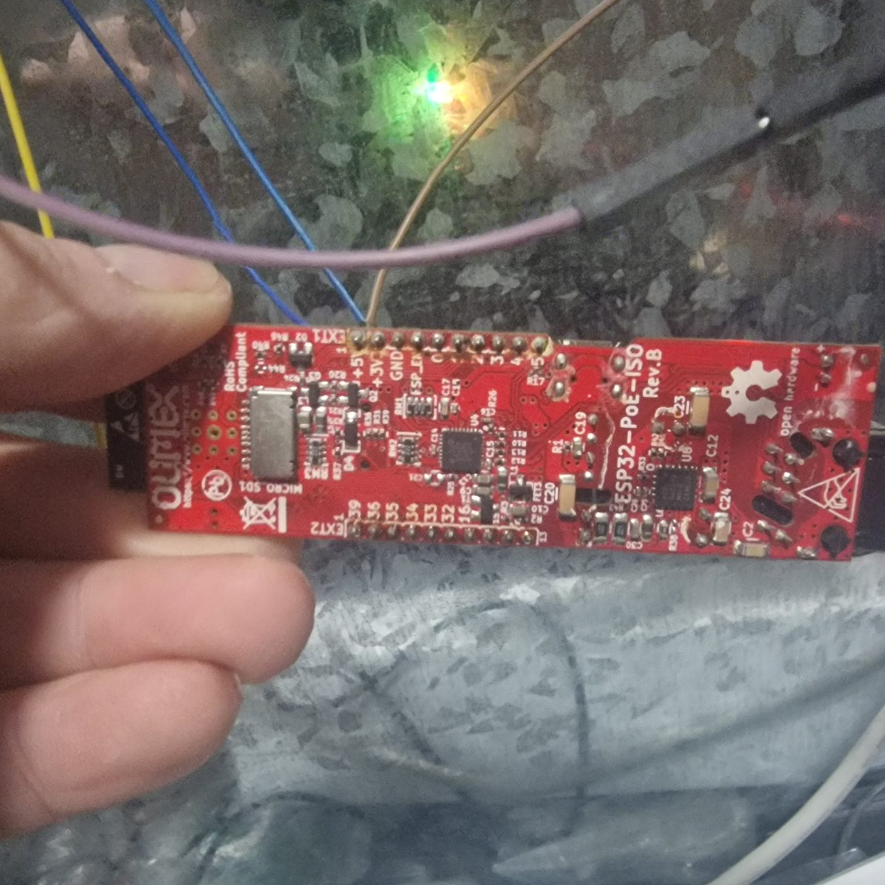
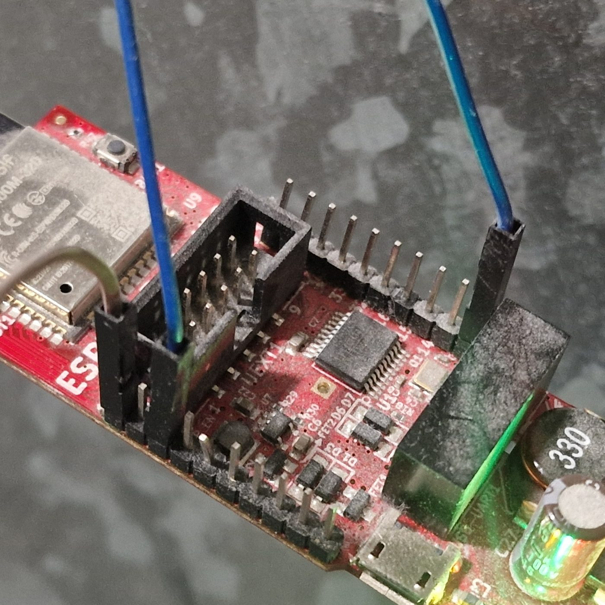
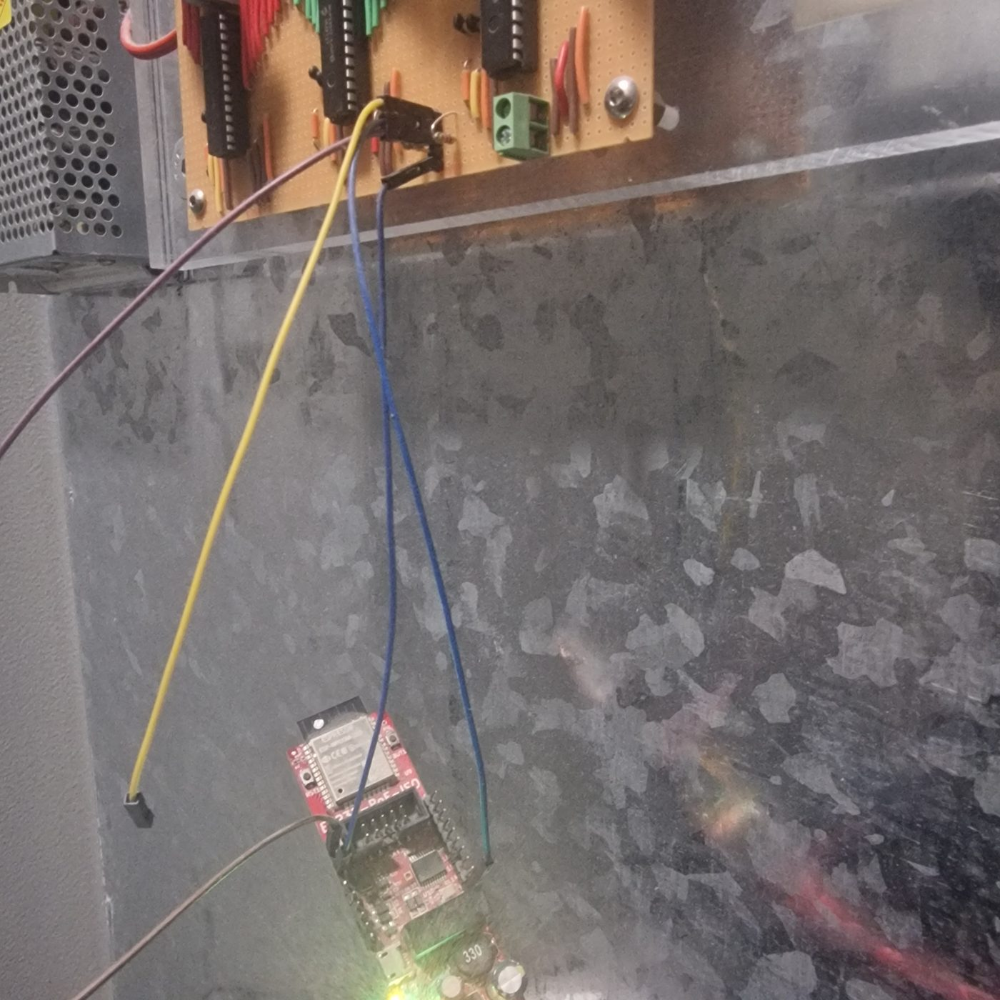

# Service Lights

The house lighting is switched by a "temporary" (2019) rig in the services cabinet:
an **Olimex ESP32-PoE-ISO** running ESPHome drives three **MCP23017** I/O expanders on a
hand-built veroboard, which drive transistor stages and the lighting relays.
Home Assistant talks to the ESP32 over Ethernet using the ESPHome native API.

## Wiring

| Signal | ESP32-PoE-ISO pin | Jumper colour | Status |
|---|---|---|---|
| SDA (I2C data) | **EXT2 pin 10**, GPIO13 (end pin nearest the Ethernet jack) | blue | confirmed (config and photos) |
| SCL (I2C clock) | **EXT2 pin 7**, GPIO16 (3rd pin back from SDA) | yellow | confirmed (reconnected here 21 Nov 2026, lights restored) |
| GND | EXT1 pin 3 | blue | from photos, verify |
| Power to veroboard | EXT1 pin 1 (+5V)? | thin brown | from photos, **verify with a meter** |
| (veroboard to PSU) | n/a | purple | from photos |

The firmware config (2019) is
[`esp32Yml/service_lights.yml`](https://github.com/DanielBryars/HomeAutomation/blob/master/esp32Yml/service_lights.yml)
in the HomeAutomation repo. The modernised version is in [`/esphome/service_lights.yaml`](../../esphome/service_lights.yaml).

> **5 V caution.** If the brown wire really is on +5V and the I2C pull-ups go to that rail,
> GPIO13/16 idle at 5 V, but the ESP32 is rated for 3.3 V. It has survived since 2019, but measure
> SDA/SCL to GND at idle. The replacement board should use 3.3 V I2C (or a level shifter).

### How the lights are switched

Each dashboard button toggles a `switch.light_bank_<bank>_pin_<nn>` entity. Outputs are
active-low (`inverted: true`). Each output holds its relay on or off directly, so **HA's on/off
state is the light's state**. (The rapid on→off presses in the 20 Nov logbook were people
testing during the outage, not pulse relays.) The modernised firmware uses
`restore_mode: RESTORE_DEFAULT_OFF`, so lights come back as they were after an ESP reboot.

### Channel map (from the HA dashboards)

21 of the 48 outputs are on a dashboard. The rest are unlabelled, either spare or used only from the "Test" view.

| Bank 0 (0x20) | Room | Bank 1 (0x21) | Room | Bank 2 (0x22) | Room |
|---|---|---|---|---|---|
| pin 00 | Toilet | pin 00 | Mummy + Daddy | pin 01 | Storage |
| pin 01 | East Wall | pin 05 | South Top | pin 02 | Utility |
| pin 02 | West Wall | pin 08 | Workshop | pin 03 | Spare |
| pin 06 | North Top | pin 09 | Kitchen Downlights | pin 05 | En Suite |
| pin 09 | Lincolns | pin 15 | Kitchen Island | pin 08 | Bath Room |
| pin 10 | Deck *(outside)* | | | pin 10 | Max |
| pin 12 | Hallway | | | pin 14 | Backdoor *(outside)* |
| pin 14 | Entrance | | | | |
| pin 15 | Front Door *(outside)* | | | | |

`switch.lightsupstairsall` is an HA switch group of bank 1 pins 14 and 15.

## Incident: all lights stopped (20 Nov 2026)

**Symptom:** no lights responded from any dashboard (upstairs, downstairs or outside),
although HA showed every button press as successful.

**Root cause:** the yellow **SCL** jumper (EXT2-7 / GPIO16) had come off the ESP32 header. With no
I2C clock the ESP32 could not talk to any of the three MCP23017s. ESPHome 1.13.6's MCP23017 driver
fails **silently**: if a chip doesn't answer at boot it is marked failed and every later write is
dropped. The driver also has no config dump or error logging. So both HA and the ESP32 reported
"switched" while nothing reached the relays.

**Fix:** reconnected the yellow jumper to EXT2 pin 7 and power-cycled the ESP32 (unplugged the PoE
cable). The old firmware only initialises the expanders at boot, so the restart is required.

### What we checked

| # | Check | Result |
|---|---|---|
| 1 | HA reachable | Yes, on **https :8123** (not 3123). HA 2026.11.2 running. |
| 2 | Light entities and dashboards | All 48 `switch.light_bank_*` available. Every dashboard card points at a valid entity, so **HA config was fine**. |
| 3 | HA to ESP32 link | Logbook showed tonight's presses (18:33, 19:28–19:29) sent and **confirmed by the device**, so the API link was fine. |
| 4 | ESP32 health (native API log and config dump) | Ethernet up at 100 Mb/s, I2C bus configured, but **no MCP23017 section at all**. |
| 5 | ESPHome 1.13.6 source (`mcp23017.cpp`) | No `dump_config`, `mark_failed()` on first failed read, writes silently ignored. This explains the false "success". |
| 6 | Red herrings ruled out | `switch.consumer_unit_2` is a Shelly 3EM energy monitor with flaky Wi-Fi, unrelated. HA restart at 18:22 (after an 18:17 backup, likely an update) is unrelated. |
| 7 | Comparison | Stairlights (separate ESP32-PoE, ESPHome 2022.9.4, same I2C pins) found its MCP23017 at 0x20 fine, so the fault was local to the Service Lights rig. |
| 8 | Physical | Loose jumper found. Identified as SCL from the config (GPIO16), the Olimex EXT2 pinout, and photos 3–7 below. |

### Warning signs beforehand

The Service Lights ESP32 dropped off the network and rebooted on **14 Nov (14:21), 18 Nov (17:27)
and 19 Nov (19:54 and 23:11)**. That suggests a marginal power supply or connection in the cabinet. It's worth
checking the PoE switch port and the cabinet PSU.

### Follow-ups

- [x] Reconnect SCL and power-cycle
- [ ] Secure all four jumpers (hot glue or a strain-relief tie) and label them
- [ ] Measure the brown wire voltage and the SDA/SCL idle voltage (5 V question above)
- [ ] OTA to the modernised firmware ([`/esphome/service_lights.yaml`](../../esphome/service_lights.yaml)): restart
      button, uptime/status, version, and an **"I2C Expander Problem"** sensor so this fault is visible in HA
- [ ] Replace the veroboard with a proper PCB (KiCad)

## Photos (21 Nov 2026)

| | |
|---|---|
|  1. ESP32-PoE-ISO pulled out with its jumpers |  2. Veroboard: MCP23017 and the 4-way Dupont header (yellow / blue / blue / purple) |
|  3. Side view of the header: brown and blue on EXT1, blue on the far end |  4. Top view, UEXT box header (unused) |
|  5. Underside silkscreen: EXT1 `+5 +3V GND ESP_EN 0 1 2 3 4 5`, EXT2 `39 36 35 34 33 32 16 15 14 13` |  6. Blue SDA jumper on the end pin of EXT2 (GPIO13) |
|  7. **The culprit:** yellow SCL jumper hanging loose | |
